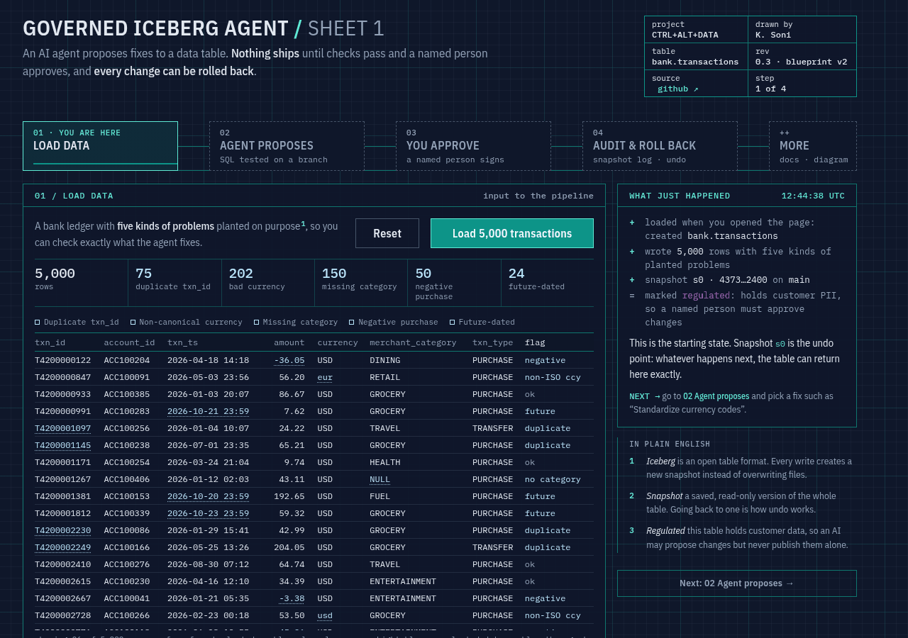
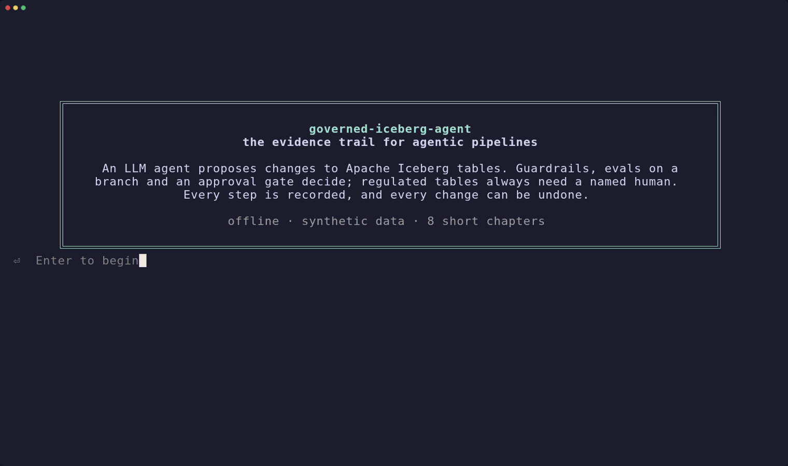
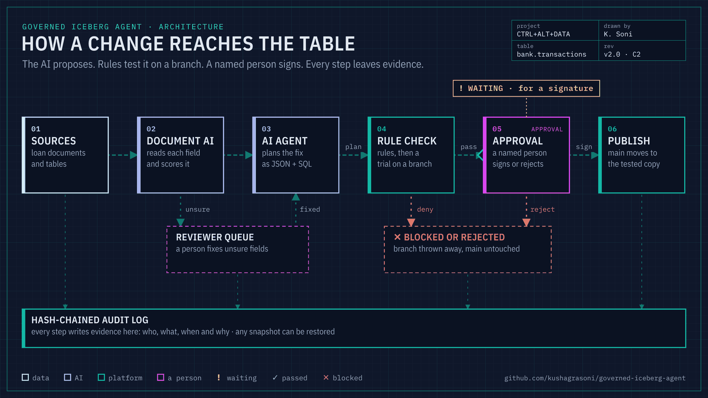

# governed-iceberg-agent

[](https://github.com/kushagrasoni/governed-iceberg-agent/actions/workflows/ci.yml)
[](https://codespaces.new/kushagrasoni/governed-iceberg-agent)
[](https://huggingface.co/spaces/kushagrasoni/governed-iceberg-agent)

**The evidence trail for agentic pipelines.** An LLM agent may *propose* changes to Apache
Iceberg tables. It never gets to just make them, and every step it takes leaves a record you can
hand to an auditor.

[](https://huggingface.co/spaces/kushagrasoni/governed-iceberg-agent)

*The [live app](https://huggingface.co/spaces/kushagrasoni/governed-iceberg-agent) walks you through it in four steps: load data, agent proposes, you approve, audit & roll back. Document AI and the architecture diagram are under **More**.*



*A real `gia demo --pause` run, recorded with [VHS](https://github.com/charmbracelet/vhs) from
[docs/demo.tape](docs/demo.tape) (about 90 seconds; each chapter gets a title card and then its
results). A sharper copy is in [docs/demo.mp4](docs/demo.mp4).*

## Why this exists

Picture a scheduled agent that "fixes" currency codes in a regulated transactions table at 2 a.m.
Three weeks later an examiner asks four questions: who approved that change, which model
proposed it, what data it looked at, and can you put the table back the way it was? If the
pipeline wasn't built to answer them, someone ends up rebuilding the story from job logs and
chat threads.

This repo is a small, working answer. Each proposal is a structured JSON plan. Guardrails check
it, it runs on an Iceberg branch or a staging table, and evals test what was actually written.
Then the approval gate decides. Anything that writes to a regulated table needs a named person,
even a low-risk change. Only low-risk changes outside the regulated tables can be auto-approved.
Every change can be rolled back to an exact earlier snapshot.

The record is made of Iceberg snapshots and tags, a provenance record per plan (model, prompt
hash, input snapshot, policy and code version), OpenTelemetry-style trace spans for each tool
call, and a hash-chained audit log you can verify with one command.

The working rule: an agent can act on bank data only when every action is **reviewable** and
**reversible**.

Everything runs on a laptop: PyIceberg with a SQLite catalog on the local filesystem and DuckDB
for sandboxed transforms. You need no cloud keys and no Docker. **All data is generated and made up** (see
[DATA_NOTICE.md](DATA_NOTICE.md)).

## What you're seeing in the demo

1. **Data and seeded issues.** A 5,000-row generated `bank.transactions` table with planted
   defects (bad currency codes, replayed duplicates, future-dated rows), and what the profiler finds.
2. **The agent proposes.** The agent turns a goal into a JSON plan (operation, SQL, rationale,
   risk tier). Its provenance (model, prompt hash, input snapshot, policy and code version) is
   recorded before anything runs.
3. **Guardrails block risky plans.** A raw-PII export, a 32% "purge" and a `DROP TABLE` are
   stopped, each with the rule that fired.
4. **Branch dry-run and evals.** Safe plans are rehearsed on an Iceberg branch or staging table
   and must pass every eval (for example non-canonical currency 202 → 0) before the approval gate
   sees them.
5. **Human approval gate.** A named approver signs each change to a regulated table, even a LOW-risk
   one. A HIGH-risk delete is refused for a standard reviewer and approved by an elevated one. The
   one auto-approval is a LOW-risk derived table in the non-regulated `analytics` namespace.
6. **Document AI confidence routing.** Fields extracted below the 0.90 confidence bar go to a
   reviewer queue; resolved documents then go through the same gate.
7. **Evidence trail.** Tagged Iceberg snapshots, a verified hash-chained audit log, the trace
   spans of one change, and its provenance record.
8. **Rollback.** An unsafe undo is refused; the delete and the dedup are then rolled back to
   exact earlier snapshots while the currency fix stays.

Then a **scorecard** counts what was proposed, executed, blocked, refused, reviewed and rolled
back, and re-verifies the audit chain.

**Ways to run it**

```bash
gia demo                 # story mode (default): all 8 chapters, no pauses
gia demo --pause         # presenting live: a title card per chapter, Enter to advance
gia demo --interactive   # you are the approver: answer the y/N approval prompts yourself
gia demo --fast          # plain log output, no formatting (what CI runs)
```

`--pause` and `--interactive` can be combined. With no terminal attached (CI, pipes),
`--pause` simply carries on without waiting.

## Try it in 5 minutes

You need Python 3.10 or newer and git. Everything runs offline after the install: no cloud
account, no API key, no Docker.

1. Get the code:
   ```bash
   git clone https://github.com/kushagrasoni/governed-iceberg-agent.git
   cd governed-iceberg-agent
   ```
2. Create and activate a virtual environment:
   ```bash
   python3 -m venv .venv
   . .venv/bin/activate
   ```
3. Install the project (with the test tools):
   ```bash
   pip install ".[dev]"
   ```
4. Run the demo:
   ```bash
   gia demo
   ```
5. Optional, run the tests:
   ```bash
   pytest
   ```

`gia demo` takes about 5 to 10 seconds on a laptop and writes its evidence to `./.lakehouse/`.
Every number on screen is read back from that run (audit log, traces, provenance records and
Iceberg metadata). None of it is hard-coded.

Prefer not to install anything? Click **Open in GitHub Codespaces** above, wait for the setup to
finish, then run `gia demo` in the terminal.

## How the pieces fit

<picture>
  <source media="(prefers-reduced-motion: no-preference)" srcset="docs/architecture.gif">
  
</picture>

*The animated diagram falls back to a still ([docs/architecture.png](docs/architecture.png)) if your system asks for reduced motion. Colour shows who acts (data, AI, a person, the platform); red, amber and green appear only as status, always with an icon and a word.*

More detail, including how this maps to Polaris, Spark and Trino in production, is in
[docs/architecture.md](docs/architecture.md).

## Why "evidence trail" and not "SR 11-7 compliance"

For fifteen years U.S. model-risk guidance meant SR 11-7 (Federal Reserve, April 2011) and its OCC
twin, Bulletin 2011-12. On **April 17, 2026** the Federal Reserve, OCC and FDIC replaced it with
**SR 26-2 / OCC Bulletin 2026-13**, *Revised Guidance on Model Risk Management*. The SR letter
"supersedes and replaces SR letter 11-7" and also SR 21-8, the 2021 statement on BSA/AML models.
The OCC bulletin rescinds Bulletins 2011-12 and 2021-19, and the FDIC rescinded FIL-22-2017 and
FIL-27-2021 the same day.

Footnote 3 of the revised guidance reads:

> "Generative AI and agentic AI models are novel and rapidly evolving. As such, they are not within
> the scope of this guidance. Nonetheless, a banking organization's risk management and governance
> practices should guide the determination of appropriate governance and controls for any tools,
> processes, or systems not covered in this document. However, the principles described in this
> guidance apply to traditional statistical and quantitative models and non-generative,
> non-agentic AI models."
> ([SR 26-2 PDF](https://www.federalreserve.gov/supervisionreg/srletters/SR2602.pdf), p. 3 of the guidance, footnote 3)

So the revised model-risk guidance does not cover the agent here. Its controls have to come from
the bank's own risk management and governance, and this repo is a concrete starting point for
those. (The guidance's definition of "model" also leaves out "deterministic rule-based processes",
which would cover the offline mock planner as well.)

The repo borrows the long-standing model-risk *principles* (effective challenge, validation before
use, documentation) and pairs them with NIST AI RMF 1.0 and the NIST Generative AI Profile
(NIST AI 600-1). It does **not** claim compliance with anything.

## Commands

State goes to `./.lakehouse/` (override with `--home` or `GIA_HOME`). CI runs the tests and the
demo on Python 3.10, 3.11, 3.12 and 3.13 (Linux). Developed with PyIceberg 0.12.0 and DuckDB 1.5.

Individual commands:

```bash
gia init                                   # catalog + generated bank.transactions / bank.loan_applications
gia profile                                # data-quality metrics
gia propose --goal "remove duplicate transactions" --planner mock
gia run --goal "standardize currency codes" --approver your.name           # prompts y/N
gia run --goal "build a daily summary derived table" --auto-approve-low-risk
gia rollback <plan_id> --approver your.name
gia audit [--plan <plan_id>] [--verify]
gia trace [<trace_id>]                     # span counts, or one trace as a tree
gia history [--table bank.transactions]    # Iceberg snapshots with plan ids and refs
gia docai generate|ingest --docs <dir>     # Document AI with confidence routing
gia review list | resolve <item> --value V --reviewer NAME
```

### Using a real LLM

The planner works with any OpenAI-compatible `/v1/chat/completions` endpoint:

```bash
export GIA_LLM_API_KEY=...                       # or OPENAI_API_KEY
export GIA_LLM_BASE_URL=https://api.openai.com/v1 # or your internal gateway
export GIA_LLM_MODEL=gpt-4o-mini
gia run --goal "fix data quality" --planner llm --approver your.name
```

`--planner auto` (the default) uses the LLM when a key is set and falls back to the deterministic
rule-based **mock planner** otherwise. LLM output is treated as untrusted input. It is parsed,
validated, policy-checked and evaluated exactly like mock output. *This build's LLM path was
tested against a local fake OpenAI-compatible server (`tests/test_llm_planner.py`), not a live
model.*

## What the demo shows

The plain log of the same walkthrough, from `gia demo --fast` in a clean clone (Python 3.12,
commit `89ba7e5`, 2026-10-18). The excerpts below are copied as printed, minus blank lines; the one
shortened line is marked with ….
Full output: [docs/sample-run/gia-demo.txt](docs/sample-run/gia-demo.txt). Snapshot, plan and trace
ids differ per run. Audit timestamps are stored in UTC.

**Generated data with seeded defects.** The profiler finds a few more than were planted, because
the generator's own random data has some.
```
=== 1. Init local Iceberg lakehouse (SQLite catalog + local files, generated data) 
  seeded bank.transactions: 5000 rows, snapshot 8746992293146341987
  seeded defects: {'noncanonical_currency': 197, 'null_merchant_category': 147, 'negative_purchase_amount': 49, 'future_dated': 24, 'duplicate_rows': 75}
  profile: {'row_count': 5000, 'null_txn_id': 0, 'duplicate_txn_id': 75, 'noncanonical_currency': 202, 'null_merchant_category': 150, 'negative_purchase_amount': 50, 'future_dated': 24}
```

**Safe changes go through Write-Audit-Publish.** Step 3 is the interesting one: the change is LOW
risk and auto-approval is on, but the table is regulated, so a person still signs. Step 4 writes
to the non-regulated `analytics` namespace and is the only auto-approval in the run.
```
=== 2. Safe, approved changes (Write-Audit-Publish on an Iceberg branch) 
  [EXECUTED] p-d6454da7a8 FIX_DATA_QUALITY     tier=MEDIUM -> bank.transactions
             approved by reviewer.alex via demo-simulated
             snapshot 8746992293146341987 -> 1930162885099378059   trace=35a35934914eff3f5ddf99172e76f6fd
=== 3. LOW tier but regulated table -> --auto-approve-low-risk does NOT apply 
  [EXECUTED] p-9ab00a9de9 ADD_COLUMN           tier=LOW    -> bank.transactions
             approved by reviewer.alex via demo-simulated
             snapshot 1930162885099378059 -> 7902840283944095118   trace=aadeee80a58e71fcbe8a3be8b08855f3
=== 4. LOW tier, non-regulated analytics table -> auto-approved =======
  [EXECUTED] p-db9b39744a CREATE_DERIVED_TABLE tier=LOW    -> analytics.daily_merchant_summary
             approved by auto-policy via auto-low-risk
             snapshot None -> 3567770824131279653   trace=5058de8525be39daa468eb55191c2465
=== 5. Deduplicate replayed transactions (MEDIUM) =====================
  [EXECUTED] p-69569aa09b DEDUPLICATE          tier=MEDIUM -> bank.transactions
             approved by reviewer.alex via demo-simulated
             snapshot 7902840283944095118 -> 5133585525843165488   trace=f4f6bb9efb67b104446fd7566e472d10
```

**Guardrails stop what a careless agent proposes, and the approval gate checks roles.**
```
=== 6. Guardrails: what a careless agent proposes =====================
  [BLOCKED ] p-a776f0888c CREATE_DERIVED_TABLE tier=LOW    -> analytics.marketing_contacts
             raw PII columns referenced: ['customer_email', 'customer_name'] (allowed only inside ['sha256', 'md5'])
  [BLOCKED ] p-b0845ffce0 DELETE_ROWS          tier=HIGH   -> bank.transactions
             32.45% of rows changed > hard limit 25.0%; 32.45% of rows removed > 5.0%
  [BLOCKED ] p-2eac6b37f0 DROP_TABLE           tier=HIGH   -> bank.transactions
             DROP_TABLE is irreversible on this platform; agents may only take reversible actions
=== 7. HIGH tier delete: standard reviewer is refused, elevated approver required 
  [REJECTED] p-60965de4a8 DELETE_ROWS          tier=HIGH   -> bank.transactions
             HIGH requires role 'elevated', approver has 'standard'
  [EXECUTED] p-2215880782 DELETE_ROWS          tier=HIGH   -> bank.transactions
             approved by mrm.officer.priya via demo-simulated
             snapshot 5133585525843165488 -> 393665402369891699   trace=e3830c3110a2c1e8b667d64fe424f628
```

**Document AI with per-field confidence routing.** Two clean documents load straight away (still
behind a human approval, because `bank.loan_applications` is regulated). The other six wait until a
reviewer resolves the low-confidence field.
```
=== 8. Document AI with per-field confidence routing ==================
  extracted 8 docs: ready=2 held=6 queued_fields=6
    held loan_app_002.txt: ['annual_income']
    held loan_app_003.txt: ['loan_amount']
    held loan_app_004.txt: ['application_date']
    held loan_app_006.txt: ['annual_income']
    held loan_app_007.txt: ['loan_amount']
    held loan_app_008.txt: ['application_date']
  [EXECUTED] p-4d8c4365de APPEND_RECORDS       tier=MEDIUM -> bank.loan_applications
             approved by reviewer.alex via demo-simulated
             snapshot 3651590677270913634 -> 752532673956218148   trace=d78c9ef507b8ab6bd3872a8a2b49848a
  reviewer resolves the queue (simulated reviewer reads the generated answer key):
    3dc5a1c2:annual_income     annual_income     raw='$153,OOO'   conf=0.72 -> 153000.0
    f7f4e913:loan_amount       loan_amount       raw='$1?,500'    conf=0.20 -> 13500.0
    0365c1b8:application_date  application_date  raw='09/23/26'   conf=0.80 -> '2026-09-23'
    b627c51a:annual_income     annual_income     raw='$2O2,OOO'   conf=0.72 -> 202000.0
    1347e024:loan_amount       loan_amount       raw='$1?,000'    conf=0.20 -> 12000.0
    a8d404c3:application_date  application_date  raw='09/16/26'   conf=0.80 -> '2026-09-16'
  [EXECUTED] p-4509c2ac93 APPEND_RECORDS       tier=MEDIUM -> bank.loan_applications
             approved by reviewer.alex via demo-simulated
             snapshot 752532673956218148 -> 8274209765539018920   trace=e799e9f6780f1edebe20385c420d4362
  bank.loan_applications rows: 8; reviewed rows: 6
```

**Reversibility.** Undoing the dedup first is refused, because the delete sits on top of it. Newest
first works, and the currency fix stays.
```
=== 9. Reversibility ==================================================
  rollback of p-69569aa09b refused: bank.transactions has moved on (current=393665402369891699, expected=5133585525843165488); rolling back would also discard later changes. Re-run with --force after review.
  rolled back p-2215880782: {'table': 'bank.transactions', 'from_snapshot_id': 393665402369891699, 'restored_snapshot_id': 5133585525843165488, 'dropped_columns': []}
  rolled back p-69569aa09b: {'table': 'bank.transactions', 'from_snapshot_id': 5133585525843165488, 'restored_snapshot_id': 7902840283944095118, 'dropped_columns': []}
  profile now: {'row_count': 5000, 'null_txn_id': 0, 'duplicate_txn_id': 75, 'noncanonical_currency': 0, 'null_merchant_category': 150, 'negative_purchase_amount': 50, 'future_dated': 24}
```

**Evidence.**
```
=== 10. Evidence ======================================================
  audit log  : ./.lakehouse/audit/audit.jsonl -> 84 records, chain intact, head=78b9e74d669a
  audit table: governance.agent_audit rows = 84
  traces     : ./.lakehouse/traces/traces.jsonl -> 118 spans in 26 traces
  provenance : ./.lakehouse/provenance (11 prompt records)
```

### The approval prompt (real run, piped answers)

From [docs/sample-run/interactive-approval.txt](docs/sample-run/interactive-approval.txt), which
also has the rollback, `gia audit --verify` and the full plan file:

```
$ printf "y\nCHG-1042 reviewed diff + DQ checks\n" | gia run --goal "fill missing merchant category" --planner mock --approver kushagra.s
PLAN p-a8252f8582  FIX_DATA_QUALITY  ->  bank.transactions
  rationale : Null merchant_category breaks downstream spend reporting; use an explicit UNCATEGORIZED bucket instead of NULL.
  sql       : SELECT * REPLACE (coalesce(merchant_category, 'UNCATEGORIZED') AS merchant_category) FROM source
  risk tier : MEDIUM (planner declared MEDIUM); regulated target: True
  dry run   : branch wap_p_a8252f8582 snapshot 7338717900379086671
  diff      : {'pre_rows': 5000, 'post_rows': 5000, 'removed_or_modified': 150, 'added_or_modified': 150, 'rows_changed': 150}
  checks    : operation_allowlisted=ok, namespace_writable=ok, target_exists=ok, sql_single_statement=ok, sql_is_select=ok, sql_no_ddl_dml=ok, pii_in_place_untouched=ok, … (18 checks, all ok)
Approve plan p-a8252f8582 [MEDIUM, REGULATED] as kushagra.s (standard)? [y/N]: Reason / ticket reference:   [EXECUTED] p-a8252f8582 FIX_DATA_QUALITY     tier=MEDIUM -> bank.transactions
             approved by kushagra.s via interactive
             snapshot 5378620011383155603 -> 7338717900379086671   trace=cb0142933d96a08d5cfe6b3db2f34ee2
```

The same plan's audit trail, trace and Iceberg history (after the rollback):

```
$ gia audit --plan p-a8252f8582
   2 2026-10-18T10:16:06.559+00:00 PROPOSED             p-a8252f8582   mock-planner     FIX_DATA_QUALITY by rule-based-mock prompt=3257dadc7194
   3 2026-10-18T10:16:06.625+00:00 POLICY_EVALUATED     p-a8252f8582   policy-engine    static: ALLOW tier=MEDIUM failed=[]
   4 2026-10-18T10:16:06.705+00:00 DRY_RUN_COMPLETED    p-a8252f8582   executor         
   5 2026-10-18T10:16:06.785+00:00 EVAL_COMPLETED       p-a8252f8582   evaluator        passed=True failed=[] diff={'added_or_modified': 150, 'post_rows': 5000, 'pre_rows': 5000, 'removed_or_modified': 150, 'rows_changed': 150}
   6 2026-10-18T10:16:06.802+00:00 POLICY_EVALUATED     p-a8252f8582   policy-engine    blast_radius: ALLOW tier=MEDIUM failed=[]
   7 2026-10-18T10:16:06.817+00:00 APPROVAL_RECORDED    p-a8252f8582   kushagra.s       APPROVED by kushagra.s (interactive) at 2026-10-18T10:16:06+00:00
   8 2026-10-18T10:16:06.840+00:00 EXECUTED             p-a8252f8582   executor         bank.transactions 5378620011383155603 -> 7338717900379086671 rollback=restore_snapshot
$ gia trace cb0142933d96a08d5cfe6b3db2f34ee2
agent.run_plan                   297.2 ms  OK  
  guardrail.static_policy            1.5 ms  OK  {'decision': 'ALLOW', 'risk_tier': 'MEDIUM', 'failed': []}
  tool.dry_run                      63.4 ms  OK  {'staged_snapshot_id': 7338717900379086671}
  eval.pre_execution                64.3 ms  OK  {'passed': True, 'failed': []}
  guardrail.blast_radius             0.0 ms  OK  {'decision': 'ALLOW', 'risk_tier': 'MEDIUM'}
  human.approval_gate                0.1 ms  OK  {'risk_tier': 'MEDIUM', 'decision': 'APPROVED', 'approver': 'kushagra.s'}
  tool.iceberg_commit                7.7 ms  OK  {'post_snapshot_id': 7338717900379086671}
$ gia rollback p-a8252f8582 --approver ops.lead
{
  "table": "bank.transactions",
  "from_snapshot_id": 7338717900379086671,
  "restored_snapshot_id": 5378620011383155603,
  "dropped_columns": []
}
$ gia history
* 5378620011383155603  parent=-                    append    plan=-              stage=seed     refs=main
  2131743423538005965  parent=5378620011383155603  delete    plan=p-a8252f8582   stage=dry-run  refs=
  7338717900379086671  parent=2131743423538005965  append    plan=p-a8252f8582   stage=dry-run  refs=approved-p-a8252f8582
$ gia audit --verify
OK   9 records, chain intact, head=072e407743ed
```

After the rollback, the published snapshot still exists and keeps its `approved-<plan>` tag. Main
just points back at the seed snapshot. The record of what happened survives the undo.

Provenance record written for that plan (the `provenance` half of `.lakehouse/plans/p-a8252f8582.json`):

```json
{
  "planner": "mock-planner",
  "model": "rule-based-mock",
  "model_version": "governed-iceberg-agent 0.1.0 / rules sha256:a3d803685164c501",
  "endpoint": null,
  "temperature": null,
  "system_prompt_sha256": "06b3dc7a250bc506a887ea2f6c85c02b54767a6af6db52bab08d2ae2ad710023",
  "user_prompt_sha256": "3257dadc7194b2bbbd91744fa1f42b23a20bbed476d162392d1ef5d79f84f005",
  "response_sha256": "08dfbdd92920ea44509f35ae89c53e8831a84b2f5f84f8f79c25f7121c707676",
  "prompt_record": "./.lakehouse/provenance/p-a8252f8582.prompt.json",
  "prompt_record_sha256": "5464453539c6a5da0cb99f79395b39ab4e7bc0142f10d7b7eae95cc7f7395b08",
  "inputs": [
    {
      "kind": "iceberg_table",
      "table": "bank.transactions",
      "snapshot_id": 5378620011383155603,
      "table_uuid": "4be0841d-5cff-49d2-b7d1-2eeba02af84b"
    }
  ],
  "policy_version": "2026.10-demo",
  "code_version": "0.1.0+89ba7e5",
  "generated_at": "2026-10-18T10:16:06+00:00"
}
```
With `--planner llm` the same record holds the provider's returned `model`, `system_fingerprint`
(as `model_version`), `response_id`, endpoint host and token usage.

## How it works (one paragraph per control)

* **Structured plans** (`plan.py`). A plan has an operation, target table, a single DuckDB `SELECT`
  over `source` that returns the full post-change table, a rationale, a declared risk tier and an
  `expected_effect` (e.g. `{"duplicate_txn_id": 0}`). Deletes are written as `SELECT … WHERE NOT (…)`.
  The agent describes the end state, and the platform computes the diff.
* **Guardrails** (`policy.py`, `default_policy.json`). Operations must be on an allowlist.
  Irreversible operations (`DROP_TABLE`, `DROP_COLUMN`, `TRUNCATE`, `EXPIRE_SNAPSHOTS`,
  `REWRITE_SCHEMA_TYPE`) are refused.
  `DELETE_ROWS` needs an *elevated* approver. SQL must be one read-only statement with no DDL/DML
  keywords. Derived tables may not carry raw PII, only `sha256()`/`md5()` of it. In-place changes
  that touch PII escalate to HIGH. Blast radius: more than 10% of rows changed escalates to HIGH,
  more than 25% is denied, and more than 5% of rows removed is denied. The final tier is
  `max(base, declared, escalations)`, so the agent can raise its own tier but never lower it.
* **Sandboxed transforms** (`lakehouse.sandboxed_sql`). DuckDB runs in memory with
  `enable_external_access=false` and a locked configuration. The only relations it can see are the
  ones passed in.
* **Dry run and evals** (`executor.dry_run`, `evals.py`). Data changes are written to an Iceberg
  branch `wap_<plan_id>`, and main is not touched. Schema changes and new tables go to a staging
  table, because an Iceberg schema is table-wide. Evals then run on what Iceberg actually stored:
  schema compatibility (additive only), not-null rules, DQ no-regression on every metric, the
  expected effect, PII values unchanged, an SSN/email value scan on derived outputs, and row-count
  rules per operation.
* **Human approval gate** (`approval.py`). It fails closed: no answer, EOF or no named approver means
  REJECTED. MEDIUM needs a named human. HIGH needs role `elevated`. `--auto-approve-low-risk`
  applies only to LOW tier plans that do **not** write to a regulated table. Planner identities can't
  approve their own plans. The audit log records approver, role, channel, reason and timestamp.
* **Publish = the evaluated snapshot** (`executor.publish`). For branch writes, main moves to the
  exact snapshot that was evaluated and gets an `approved-<plan_id>` tag. Nothing is recomputed. If
  main has moved since the dry run, publish refuses (`StaleBaseError`).
* **Rollback** (`executor.rollback`). Every EXECUTED event stores a rollback pointer: the
  pre-change snapshot (plus columns to drop for `ADD_COLUMN`), or the uuid of the table to drop for
  a derived table. Rollback refuses if later changes would be lost unless `--force` is given, and it
  refuses a second rollback of the same plan.
* **Audit** (`audit.py`). An append-only JSONL file (`O_APPEND` + fsync) where each record holds the
  SHA-256 of the previous one. `gia audit --verify` detects edits, deletions and reordering. Each
  record is mirrored into the Iceberg table `governance.agent_audit` so you can query it with SQL.
* **Traces** (`tracing.py`). Every tool call becomes a span with `trace_id`, `span_id`,
  `parent_span_id`, timings, attributes and status, using OpenTelemetry field names so the records
  can be mapped onto an OTLP exporter.
* **Provenance** (`pipeline._record_provenance`). Each plan records the planner, model and model
  version, prompt hashes, the full prompt and response file, its inputs (table snapshot id and uuid,
  staged batch hashes, document SHA-256s with per-field confidences), the policy version and the
  code version.
* **Document AI** (`docai.py`). A deterministic regex extractor scores confidence per field
  (OCR substitutions, smudged digits and ambiguous dates score low). Any field below 0.90 goes to
  an append-only reviewer queue, and the document waits. Clean documents, and documents whose
  fields a named reviewer has resolved, become one `APPEND_RECORDS` plan that goes through the same
  gate.

## Mapping to SR 26-2, SR 11-7 (historical), NIST AI RMF 1.0 and NIST AI 600-1

The rows below are design inspiration, not a compliance claim. SR 26-2 explicitly puts generative
and agentic AI out of scope (footnote 3, quoted above), and SR 11-7 has been superseded.

| Source (verified) | Concept | Where in this repo |
|---|---|---|
| SR 26-2 guidance §III | "Effective challenge": critical analysis by objective experts with "sufficient independence" and "standing and influence to effect any change" | `approval.py`: named human approver, `forbidden_approvers` (agents can't approve themselves), `elevated` role for HIGH; policy kept outside the agent in `default_policy.json` |
| SR 26-2 guidance §III | Risk management tailored, "with a level of rigor commensurate with that risk" | Risk tiers per operation, escalations (PII, blast radius), `tier_max` so the planner can't lower its tier |
| SR 26-2 guidance §V | "Validation generally occurs prior to a model's first use" | Pre-execution evals on an Iceberg branch or staging table; nothing publishes unless every check passes (`evals.py`) |
| SR 26-2 guidance §VI | Governance "supported by clear policies and effective controls"; roles and responsibilities | Versioned `default_policy.json` (`policy_version` stamped in every provenance record); `standard`/`elevated` roles |
| SR 26-2 guidance §VI (Documentation) | Documentation supports "tracking of recommendations, responses, and exceptions" | Audit events `PROPOSED`, `BLOCKED`, `APPROVAL_RECORDED`, `DISCARDED`, `ROLLBACK_REFUSED`, `ROLLED_BACK` |
| SR 11-7 attachment §V, Ongoing Monitoring (historical, 2011) | Code "subject to rigorous quality and change control procedures … all changes are logged and can be audited" | Hash-chained `audit.jsonl` + Iceberg snapshot summaries (`gia.plan_id`) + `approved-<plan>` tags |
| NIST AI RMF 1.0, GOVERN 1.4 | Risk management outcomes established "through transparent policies, procedures, and other controls" | Policy-as-data; every decision logged with the failing checks |
| NIST AI RMF 1.0, GOVERN 2.1 | Roles and responsibilities documented | Approver roles; approver identity in every approval record |
| NIST AI RMF 1.0, MAP 1.5 | "Organizational risk tolerances are determined and documented" | `blast_radius` thresholds, `max_rows_removed_pct`, `docai.confidence_threshold` |
| NIST AI RMF 1.0, MAP 3.5 | "Processes for human oversight are defined, assessed, and documented" | Approval gate rules; regulated tables always need a human; reviewer queue for low-confidence fields |
| NIST AI RMF 1.0, MEASURE 2.3 | Performance "demonstrated for conditions similar to deployment setting(s)" | Dry run on a branch of the *real* table; evals read back what Iceberg stored |
| NIST AI RMF 1.0, MEASURE 2.7 | Security and resilience evaluated | DuckDB sandbox (no file/network access), single-statement SQL, DDL/DML keyword block, LLM output validated as untrusted |
| NIST AI RMF 1.0, MEASURE 2.10 | Privacy risk examined and documented | PII column rules, masking-function requirement, SSN/email value scan, `pii_values_unchanged` eval |
| NIST AI RMF 1.0, MANAGE 1.1 | Determine "whether its development or deployment should proceed" | Each plan's go/no-go is an explicit, logged decision |
| NIST AI RMF 1.0, MANAGE 2.3 / 2.4 | Respond to and recover from risks; mechanisms to "supersede, disengage, or deactivate" | `gia rollback`, fail-closed approvals, `--planner mock` fallback |
| NIST AI RMF 1.0, MANAGE 4.1 | Post-deployment monitoring incl. "appeal and override, decommissioning, incident response, recovery" | Traces + audit log + rollback with `ROLLBACK_REFUSED` safety |
| NIST AI 600-1, GV-1.6-003 | Inventory entries should include "Data provenance information (e.g., source, signatures, versioning…)" and "versions of underlying models" | Provenance record: model, model_version / system fingerprint, endpoint, prompt hashes, input snapshot ids, document SHA-256s |
| NIST AI 600-1, MS-2.8-003 | Document "each instance where content is generated, modified, or shared to provide a tamper-proof history"; version control across the lifecycle | Hash chain + Iceberg snapshots/tags; `code_version` (git sha) on each plan |
| NIST AI 600-1, MG-2.2-002 | "Document training data sources to trace the origin and provenance of AI-generated content" (applied here to inference-time inputs) | `inputs[]` per plan; row-level `source_doc` / `source_sha256` on `bank.loan_applications` |
| NIST AI 600-1, Appendix A (Provenance) | Provenance metadata "can include information about GAI model developers or creators of GAI content, date/time of creation, location, modifications, and sources" | `planner`, `model`, `generated_at`, `inputs`, plus the stored prompt/response record |

Sources (each fetched and checked on 2026-10-18):
* Federal Reserve, **SR 26-2**, *Revised Guidance on Model Risk Management* (Apr 17, 2026):
  [letter](https://www.federalreserve.gov/supervisionreg/srletters/sr2602.htm) ·
  [PDF incl. guidance](https://www.federalreserve.gov/supervisionreg/srletters/SR2602.pdf) ·
  [guidance attachment](https://www.federalreserve.gov/supervisionreg/srletters/SR2602a1.pdf)
* OCC, **Bulletin 2026-13**, *Model Risk Management: Revised Guidance* (Apr 17, 2026), which rescinds OCC Bulletins 2011-12 and 2021-19:
  <https://www.occ.gov/news-issuances/bulletins/2026/bulletin-2026-13.html>
* FDIC press release, *Agencies Issue Revised Model Risk Guidance* (Apr 17, 2026):
  <https://www.fdic.gov/news/press-releases/2026/agencies-issue-revised-model-risk-guidance>
* Federal Reserve, **SR 11-7** (Apr 4, 2011, superseded): [letter PDF](https://www.federalreserve.gov/boarddocs/srletters/2011/sr1107.pdf) ·
  [guidance attachment](https://www.federalreserve.gov/boarddocs/srletters/2011/sr1107a1.pdf)
* NIST, **AI RMF 1.0** (NIST AI 100-1, Jan 2023, doi:10.6028/NIST.AI.100-1):
  [PDF](https://nvlpubs.nist.gov/nistpubs/ai/NIST.AI.100-1.pdf) ·
  [overview page](https://www.nist.gov/itl/ai-risk-management-framework). NIST notes the AI RMF 1.0
  "is being revised as part of the White House AI Action Plan".
* NIST, **AI 600-1**, *Generative AI Profile* (Jul 2024): <https://nvlpubs.nist.gov/nistpubs/ai/NIST.AI.600-1.pdf>
* Apache Iceberg [branching and tagging](https://iceberg.apache.org/docs/latest/branching/) ·
  [Spark procedures](https://iceberg.apache.org/docs/latest/spark-procedures/) ·
  [PyIceberg API](https://py.iceberg.apache.org/api/) · [Apache Polaris](https://polaris.apache.org/)
  ([1.8.0 access control](https://polaris.apache.org/releases/1.8.0/managing-security/access-control/)) ·
  [Trino Iceberg connector](https://trino.io/docs/current/connector/iceberg.html) ·
  [OpenTelemetry GenAI semantic conventions](https://github.com/open-telemetry/semantic-conventions-genai) (Development status)

## Repository layout

```
src/governed_agent/
  cli.py story.py demo.py   CLI; story-mode walkthrough (rich); plain --fast walkthrough
  plan.py                   plan schema + validation of untrusted planner output
  planners/{mock,llm}.py    offline rule-based planner; OpenAI-compatible planner
  policy.py                 guardrails, risk tiers, blast radius
  executor.py               Write-Audit-Publish on Iceberg branches / staging tables, rollback
  evals.py                  schema compat, DQ assertions, diff, PII checks
  approval.py               human approval gate
  audit.py tracing.py       hash-chained audit log; OTel-style spans
  docai.py                  generated documents, extraction, confidence routing, reviewer queue
  pipeline.py               the governor that wires it all together
  default_policy.json       the policy (owned by risk, not by the agent)
tests/                      43 pytest tests
docs/architecture.md        architecture, production mapping (Polaris/Spark/Trino), limitations
docs/architecture.gif/.png  architecture diagram (animated + still)
docs/architecture.mmd       Mermaid outline of the same flow
docs/demo.tape              VHS script that renders docs/demo.gif and docs/demo.mp4
docs/demo.gif / demo.mp4    recording of `gia demo --pause` (story mode)
.github/workflows/ci.yml    CI: tests + demo smoke test on Python 3.10-3.13
.devcontainer/              dev container used by GitHub Codespaces
CHANGELOG.md                release history
```

## Tests

```bash
pip install -e ".[dev]" && pytest
# 43 passed in ~40 s
```

They cover the guardrails (allowlist, irreversible ops, DDL/DML in SQL, PII rules, tier floor,
blast radius, sandbox, expected effect, DQ regression), the approval gate (auto-approve scope,
self-approval, roles, interactive prompt, EOF fail-closed, rejected plans leaving main untouched),
the audit log (tamper and deletion detection, event sequence, snapshot linkage, Iceberg mirror,
forced re-init archiving rather than deleting evidence),
provenance, tracing, rollback (snapshot restore, `ADD_COLUMN` and derived-table reversal, refusal
when the table has moved, `--force`, stale base), Document AI routing end to end, the LLM planner
against a fake endpoint (including a prompt-injected `DELETE`), the real CLI with a piped
approval prompt, and `gia demo` in story, `--pause` and `--fast` modes.

## Limitations

See [docs/architecture.md](docs/architecture.md#5-limitations). In short: this is a single-process
demo. The audit chain is tamper-*evident*, not tamper-*proof*. Approver identity is a CLI string,
not SSO. The PII check is name-based plus a regex value scan, which is not a classifier. The
Document AI extractor is regex-based on generated text, not OCR. The optional REST/Polaris catalog
hook (`GIA_CATALOG_NAME`) is untested.

## License

MIT, see [LICENSE](LICENSE). Generated, made-up data only; see [DATA_NOTICE.md](DATA_NOTICE.md).
